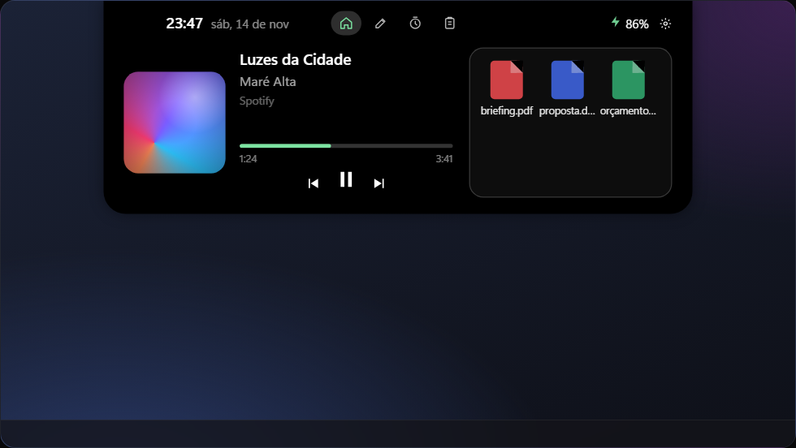

<div align="center">


# Ilha

### O topo da sua tela, finalmente útil.

A Ilha vive no topo do Windows e se abre com um passar de mouse — música, arquivos, notas,
timer e área de transferência, sempre à mão e nunca no caminho.

[](https://github.com/YamamotoDesigner/ilha/releases/latest)
&nbsp;
[](https://yamamotodesigner.github.io/ilha/)

[](https://github.com/YamamotoDesigner/ilha/releases/latest)
[](https://github.com/YamamotoDesigner/ilha/releases)


<br>



</div>

<br>

## ✨ Tudo que você abre dez vezes por dia — a um gesto de distância


| | |
|---|---|
| 🎵 **Controle de mídia** | Capa, título, progresso e controles do que estiver tocando — Spotify, YouTube no navegador, Media Player e qualquer app compatível com o Windows. |
| 📂 **Prateleira de arquivos** | Arraste arquivos para a ilha e solte onde quiser depois. Leve coisas entre pastas, e-mails e apps sem perder nada. |
| 📝 **Notas rápidas** | Um bloco sempre à mão, salvo automaticamente. |
| ⏱️ **Timer** | Pomodoro em um clique. A contagem aparece na pílula e a ilha avisa quando acabar. |
| 📋 **Área de transferência** | Histórico do que você copiou; clique para copiar de novo. Fica só na memória. |
| ⌨️ **Atalho global** | <kbd>Ctrl</kbd> + <kbd>Alt</kbd> + <kbd>N</kbd> abre e fecha de qualquer lugar. |

## 🎨 Do seu jeito

Cor da ilha e de destaque, tamanho, arredondamento, largura e altura da pílula, sombra,
animação com mola, atrasos de abertura e fechamento, monitor, relógio 24 h, quais recursos
aparecem — tudo muda ao vivo. E ela **some sozinha em jogos e vídeos em tela cheia**.

## 🔄 Sempre atualizada

Quando sai uma versão nova, a Ilha avisa. Um clique e ela se atualiza e reabre, com
configurações e notas no lugar. (Dá para desligar em Configurações → Atualizações.)

## 📥 Instalar

1. Baixe o **`Ilha-Setup-x.y.z.exe`** na [página de versões](https://github.com/YamamotoDesigner/ilha/releases/latest).
2. Execute — não precisa de administrador.
3. Se aparecer "O Windows protegeu o computador", clique em **Mais informações → Executar assim mesmo**
   (o app ainda não tem assinatura digital paga).

**Privacidade:** notas, prateleira e configurações ficam só no seu PC (`%APPDATA%\Ilha`).
A única conexão com a internet é a verificação de atualizações.

---

<details>
<summary><b>Para desenvolvedores</b></summary>

<br>

Feito em C# / WPF (.NET 10).

```powershell
dotnet run
```

**Publicar uma nova versão**

1. Aumente `<Version>` em `Ilha.csproj` e `AppVersion` em `installer/Ilha.iss`.
2. Gere o exe e o instalador:
   ```powershell
   Remove-Item publish -Recurse -ErrorAction SilentlyContinue; dotnet publish -c Release -o publish
   & "$env:LOCALAPPDATA\Programs\Inno Setup 6\ISCC.exe" installer\Ilha.iss
   ```
3. Publique: `gh release create vX.Y.Z Ilha-Setup-X.Y.Z.exe --title "Ilha X.Y.Z" --notes "..."`

Os apps instalados encontram a nova versão em até 6 horas (ou ao abrir).

O site fica em `docs/` (GitHub Pages).

</details>
