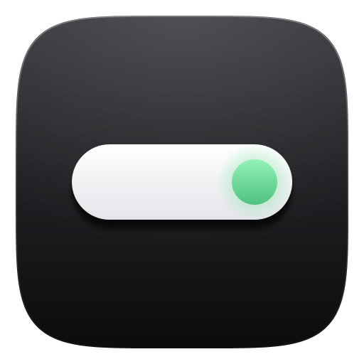
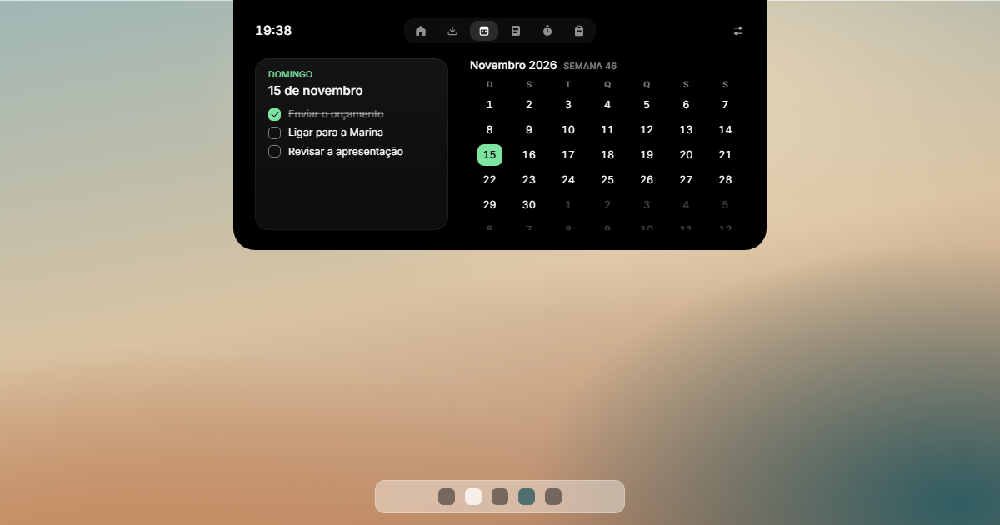

<div align="center">



# Ilha

### O topo da tela, com uma função.

Ilha é uma barra discreta no topo da tela, no Windows e no Mac. Passe o mouse e ela abre com a música
que está tocando, a sua agenda, um timer, notas e os arquivos que você quer ter à mão.

[**Baixar para Windows**](https://github.com/YamamotoDesigner/ilha/releases/latest) &nbsp;·&nbsp; [**Baixar para Mac**](https://github.com/YamamotoDesigner/ilha/releases/latest) &nbsp;·&nbsp; [Conhecer o site](https://yamamotodesigner.github.io/ilha/)

[](https://github.com/YamamotoDesigner/ilha/releases/latest)
[](https://github.com/YamamotoDesigner/ilha/releases)

<br>


</div>

<br>

## O que ela faz



| | |
|---|---|
| **Música** | Capa, título, progresso e controles do que estiver tocando: Spotify, YouTube no navegador, Media Player e qualquer app compatível com o Windows. No Spotify, o coração salva a faixa nas Músicas Curtidas. |
| **Agenda e lembretes** | Calendário em semanas que rolam: toque num dia e deixe um lembrete para ele. |
| **Foco** | Modos Foco, Pausa e Pausa longa, além de atalhos de 1 min a 1 h 30. A contagem aparece na ilha recolhida e ela avisa quando acabar. |
| **Prateleira** | Uma aba só para arquivos: arraste para a ilha e solte onde quiser depois. Downloads concluídos já aparecem lá. |
| **Notas** | Um bloco sempre à mão, salvo automaticamente. |
| **Área de transferência** | Histórico do que você copiou; clique para copiar de novo. Fica só na memória. |
| **Teleprompter** | O roteiro rola logo abaixo da câmera, com contagem 3-2-1, linha atual em destaque, velocidade ajustável e lembretes como [pausa]. |
| **Espelho** | Uma prévia redonda da câmera, que só fica ligada enquanto a aba está aberta. |
| **Monitor do sistema** | Uso de processador e memória com gráfico dos últimos segundos. |
| **Avisos rápidos** | A ilha recolhida cresce por um instante para mostrar volume, carregador conectado, música nova e downloads. |
| **Atalho global** | <kbd>Ctrl</kbd> + <kbd>Alt</kbd> + <kbd>N</kbd> abre e fecha de qualquer lugar. |

## Do seu jeito

Vidro (com o desfoque real do Windows 11) ou cor sólida. Colada na borda, solta no topo ou livre
para arrastar e redimensionar. Modo claro ou escuro, português ou inglês.
Cor da ilha e de destaque, arredondamento, tamanho fechada e aberta (com prévia), atrasos de abertura,
monitor e quais recursos aparecem: tudo muda ao vivo. Ela some sozinha em jogos e vídeos em tela cheia.

## Atualizações

Quando sai uma versão nova, a Ilha avisa. Um clique e ela se atualiza e reabre, com
configurações e notas no lugar. (Dá para desligar em Configurações → Atualizações.)

## Instalar

1. Baixe o **`Ilha-Setup-x.y.z.exe`** na [página de versões](https://github.com/YamamotoDesigner/ilha/releases/latest).
2. Execute. Não precisa de administrador.
3. Se aparecer "O Windows protegeu o computador", clique em **Mais informações → Executar assim mesmo**
   (o app ainda não tem assinatura digital paga).

**No Mac:** baixe o **`Ilha-mac-x.y.z.dmg`**, abra e arraste o Ilha para Aplicativos (macOS 13 ou mais novo).
Na primeira vez, se o Mac disser que não conseguiu verificar o app, vá em **Ajustes do Sistema → Privacidade e
Segurança → Abrir mesmo assim**.

**Privacidade:** notas, prateleira e configurações ficam só no seu PC (`%APPDATA%\Ilha`).
A única conexão com a internet é a verificação de atualizações.

---

<details>
<summary><b>Para desenvolvedores</b></summary>

<br>

Feito em C# / WPF (.NET 10).

```powershell
dotnet run
```

**Publicar uma nova versão**

1. Aumente `<Version>` em `Ilha.csproj` e `AppVersion` em `installer/Ilha.iss`.
2. Gere o exe e o instalador:
   ```powershell
   Remove-Item publish -Recurse -ErrorAction SilentlyContinue; dotnet publish -c Release -o publish
   & "$env:LOCALAPPDATA\Programs\Inno Setup 6\ISCC.exe" installer\Ilha.iss
   ```
3. Publique: `gh release create vX.Y.Z Ilha-Setup-X.Y.Z.exe --title "Ilha X.Y.Z" --notes "..."`

Os apps instalados encontram a nova versão em até 6 horas (ou ao abrir).

O site fica em `docs/` (GitHub Pages).

</details>
